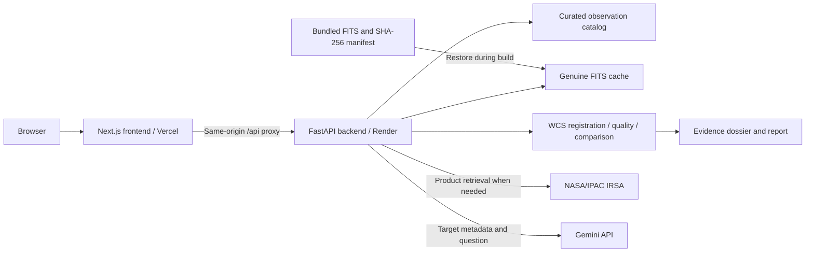

# SPHEREx Explorer

<p align="center">
  
  
  
  
  
  
  
</p>

### Explore the infrared sky. Compare observations. Follow the evidence.

SPHEREx Explorer is an independent NASA Space Apps Challenge project that turns genuine public SPHEREx observations into an interactive scientific workspace. It brings FITS image inspection, observation comparison, detector-quality screening, spectral exploration, and a Gemini research assistant into one application.

The application focuses on a curated set of astronomical targets with traceable archive products. Its purpose is to make the data understandable while keeping scientific limitations visible.

---

## Contents

- [The mission and the project](#the-mission-and-the-project)
- [Application workspaces](#application-workspaces)
- [Targets and available data](#targets-and-available-data)
- [Scientific integrity](#scientific-integrity)
- [Architecture](#architecture)
- [Project structure](#project-structure)
- [Run locally](#run-locally)
- [Environment configuration](#environment-configuration)
- [Verification](#verification)
- [API overview](#api-overview)
- [Troubleshooting](#troubleshooting)
- [Sources and acknowledgments](#sources-and-acknowledgments)

## The mission and the project

NASA's **SPHEREx**—Spectro-Photometer for the History of the Universe, Epoch of Reionization and Ices Explorer—surveys the sky in infrared light. Its science addresses the early universe, the history of galaxies, and the distribution of ingredients for life. Learn more on the [NASA mission page](https://science.nasa.gov/mission/spherex/) and in the [NASA/JPL science overview](https://www.jpl.nasa.gov/press-kits/spherex/mission-overview/science/).

SPHEREx Explorer provides an accessible way to investigate selected released observations from the [NASA/IPAC Infrared Science Archive](https://irsa.ipac.caltech.edu/Missions/spherex.html). The mission's survey coverage is broader than this application's curated catalog.

This project is an educational investigation tool. It does not claim a Planet Nine discovery, a confirmed moving-object detection, or a complete assessment of public SPHEREx coverage.

## Application workspaces

| Workspace | What you can do |
| --- | --- |
| **Overview** | Browse the predefined target catalog, view catalog counts, locate targets on a celestial-coordinate map, and enter a science workspace. |
| **Sky Explorer** | Load genuine FITS images; adjust stretch and colormap; inspect WCS coordinates, product provenance, image statistics, detector flags, variance, and usable-pixel information. |
| **Epoch Comparison** | Select observations in the same detector band; register them on a common celestial grid; use side-by-side, swipe, and blink views; inspect difference and significance maps when valid. |
| **Candidate Investigator** | Review product screening records, decoded detector flags, and caveat reasons. Preview screening tolerances without changing saved science data. |
| **Spectral Explorer** | Explore available M101 spectrophotometry by detector band, with measured flux density, uncertainty bars, observation identifiers, and sample details. |
| **Research Assistant** | Ask Gemini about the selected target, available observation metadata, and SPHEREx science. Review answers in a conversation notebook with copy and retry controls. |
| **About** | Read about the project, scientific approach, mission background, limitations, and original sources. |

**Evidence export:** Epoch Comparison provides a scientific dossier and Markdown report containing product identities, processing details, quality information, comparison validity, and evidence limitations. Reports include reproducibility information and FITS content hashes where available.

## Targets and available data

The current catalog contains **7 predefined targets and 41 observation-product records**.

| Target | Cataloged products | Bundled genuine FITS files | Current demonstration scope |
| --- | ---: | ---: | --- |
| M101 — Pinwheel Galaxy | 10 | 10 | Image exploration, compatible comparisons, evidence export, and cataloged spectrophotometry. |
| M51 — Whirlpool Galaxy | 2 | 2 | Verified image pair, registered comparison, and evidence export. |
| M33 — Triangulum Galaxy | 2 | 2 | Verified image pair, registered comparison, and evidence export. |
| NGC 253 — Sculptor Galaxy | 2 | 2 | Verified image pair, registered comparison, and evidence export. |
| Mira | 10 | 9 | Product-dependent quality limitations; one historical failed retrieval. |
| Delta Cephei | 5 | 5 | Product-dependent quality limitations, including invalid central pixels. |
| Algol | 10 | 8 | Product-dependent quality limitations; two historical failed retrievals. |

Product counts are not counts of distinct epochs or spectral channels. Some compatible pairs have short time baselines; the application reports the actual observation times rather than assuming a six-month separation.

M101 has **370 cataloged spectrophotometric samples**. These are individual measurements, not 370 unique mission spectral channels. Other targets show an insufficient-spectral-evidence state when no extracted source spectrum is supplied.

The existing catalog includes genuine QR2 and QR3 products. Each product retains its own archive URL and identity; the catalog is not presented as a comprehensive DR1/QR3 search. Arbitrary object-name and coordinate discovery is not part of the current application.

## Scientific integrity

The scientific pipeline keeps observation quality separate from an astronomical interpretation:

- **No synthetic replacement observations.** Missing or failed FITS products remain explicit failures. Test fixtures used for algorithm checks are separate from application observations.
- **Pixel states are distinct.** Nonfinite pixels are not automatically classified as saturated. Saturation interpretation depends on verified detector-flag definitions.
- **Saturated cores are not reconstructed.** Valid surrounding pixels can remain useful for suitable analyses; they do not recover missing central flux.
- **Comparisons have safeguards.** Distinct products, compatible bands, distinct observation times, valid celestial WCS, overlap, detector quality, and measured variance govern scientific validity.
- **Visual comparison is not scientific validation.** When necessary conditions fail, the application reports limitations and withholds unsupported analysis.
- **Candidates require evidence.** Residuals, pointing offsets, and AI explanations do not establish a discovery. Moving-object claims require additional positional and observational verification.
- **Provenance travels with results.** Observation identifiers, archive origins, processing information, and limitations are retained in evidence dossiers.

The Research Assistant uses available backend target and catalog context. It does not run a full image analysis for every question or retrieve live scientific literature. Answers distinguish supplied project evidence from model knowledge; they must still be checked against the original data. Questions are currently sent independently even though earlier exchanges remain visible during the page visit.

## Architecture



The frontend and backend are independently deployable. The frontend does not read Python files or FITS data. Browser requests use the frontend's `/api` path; Next.js forwards them to the configured backend origin.

| Layer | Main technologies |
| --- | --- |
| Interface | Next.js 16, React 19, TypeScript, Tailwind CSS 4, Lucide icons |
| API | FastAPI, Pydantic, Uvicorn |
| Scientific processing | Astropy, NumPy, SciPy, reproject, Pillow, Matplotlib |
| Archive access | Requests, Astroquery, genuine IRSA product URLs |
| AI explanations | Maintained `google-genai` Python SDK |
| Verification | Pytest, frontend production build, ESLint, cold-cache deployment checks |

## Project structure

```text
spherex-explorer/
├── README.md
├── frontend/
│   ├── app/                       # Pages, styles, and root layout
│   ├── components/                # Navigation, viewers, charts, and diagnostics
│   ├── lib/                       # API client, types, and selected-target state
│   ├── public/                    # Static assets
│   ├── package.json
│   ├── package-lock.json
│   ├── next.config.ts             # Backend URL validation and /api rewrite
│   └── vercel.json
└── backend/
    ├── app/
    │   ├── main.py                # FastAPI application and active routers
    │   ├── config.py              # Environment and backend-local data paths
    │   ├── api/routes/            # Observation, image, comparison, and AI APIs
    │   ├── schemas/               # Request and response contracts
    │   └── services/              # Science processing, archive, storage, and AI
    ├── data/
    │   ├── demo/                  # Required genuine catalog and photometry
    │   ├── deployment_fits/       # Exact gzip FITS bundles and hash manifest
    │   └── cache/                 # Writable runtime FITS cache; ignored by Git
    ├── scripts/                   # Data packaging, validation, and live checks
    ├── tests/
    ├── requirements.txt
    ├── pyproject.toml             # Pytest configuration
    ├── .python-version            # Python 3.12 for Render
    ├── .gitignore
    └── render.yaml
```

Despite its name, `backend/data/demo/` contains required records for genuine observations. Keep its `screening_results.csv`, `verified_targets.json`, and `m101_photometry.tbl` files.

## Run locally

### Prerequisites

- **Python 3.12**, matching `backend/.python-version`.
- **Node.js 24 LTS** and npm for the frontend.
- A **Gemini API key** to enable the Research Assistant. Image and comparison tools do not require this key.

Use two terminals, starting from the project root.

### 1. Start the backend

**Windows PowerShell**

```powershell
cd backend
py -3.12 -m venv .venv
.\.venv\Scripts\Activate.ps1
python -m pip install -r requirements.txt
python scripts/deployment_data.py restore
python -m uvicorn app.main:app --host 127.0.0.1 --port 8000 --reload
```

**macOS / Linux**

```bash
cd backend
python3.12 -m venv .venv
source .venv/bin/activate
python -m pip install -r requirements.txt
python scripts/deployment_data.py restore
python -m uvicorn app.main:app --host 127.0.0.1 --port 8000 --reload
```

If the virtual environment already exists, activate it and skip creating it again.

- Backend health: <http://127.0.0.1:8000/api/health>
- Interactive API documentation: <http://127.0.0.1:8000/docs>

### 2. Configure Gemini locally

Create `backend/.env`:

```dotenv
GEMINI_API_KEY=your_api_key_here
GEMINI_MODEL=gemini-3.1-flash-lite
```

The model must be accessible to your API project. This is the project's configured default, not a guarantee of provider availability or quota.

### 3. Start the frontend

Create `frontend/.env.local`:

```dotenv
SPHEREX_BACKEND_URL=http://127.0.0.1:8000
```

In the second terminal:

```bash
cd frontend
npm ci
npm run dev
```

Open **<http://localhost:3000>**. There is no root `package.json`; run npm commands inside `frontend` and backend commands inside `backend`.

### Suggested first investigation

1. Open **Sky Explorer** and select **M101**.
2. Load an observation and inspect the quality and provenance panels.
3. Open **Epoch Comparison** and select two distinct observations in the same band.
4. Check comparison validity and celestial overlap before interpreting a difference map.
5. Open the scientific dossier and export its evidence report.
6. Repeat with **M51**, **M33**, or **NGC 253**.
7. Open **Spectral Explorer** with M101 selected, or ask the **Research Assistant** to explain the available metadata.

## Environment configuration

| Variable | Location | Purpose |
| --- | --- | --- |
| `SPHEREX_BACKEND_URL` | Vercel or `frontend/.env.local` | Backend origin only, such as `https://your-api.onrender.com`. Do not append `/api`. |
| `GEMINI_API_KEY` | Render or `backend/.env` | Server-only Gemini credential. Required for AI answers. |
| `GEMINI_MODEL` | Render or `backend/.env` | Gemini model; default is `gemini-3.1-flash-lite`. |
| `ENVIRONMENT` | Render | Set to `production` so hosted variables are used without loading local `.env` files. |
| `SPHEREX_CACHE_DIR` | Backend, optional | Alternate writable FITS-cache directory, including a persistent-disk mount. |
| `SPHEREX_DATA_DIR` | Backend, optional | Alternate data directory containing `demo/`; normally leave unset. |
| `SPHEREX_ALLOWED_ORIGINS` | Backend, optional | Comma-separated origins for direct cross-origin browser access. Not required for the same-origin Vercel proxy. |
| `SPHEREX_MIN_COMPARISON_OVERLAP` | Backend, optional | Minimum usable overlap; default `0.5`. Preserve the scientific safeguard unless deliberately reviewing its policy. |

Never commit real `.env` files or put the Gemini key in frontend variables. `NEXT_PUBLIC_API_URL` is not used. Local backend configuration comes from `backend/.env`; in production, configure variables in Render.

## Verification

### Backend tests

With the backend virtual environment active, run from `backend/`:

```bash
python -m pytest tests -q
```

The suite covers FITS handling, detector-quality behavior, product identity, WCS registration, comparison validity, difference processing, source association, evidence provenance, deployment restoration, and relevant failure paths.

### Frontend checks

Run from `frontend/`:

```bash
npm run lint
npm run build
```

Additional scripts:

| Script, relative to `backend/` | Purpose |
| --- | --- |
| `scripts/validate_dataset.py` | Check required screening-catalog columns. |
| `scripts/verify_exploration_runtime.py` | Exercise the running local frontend proxy, FITS rendering, comparisons, and evidence reports. Requires both servers. |
| `scripts/verify_gemini_runtime.py` | Make a direct live Gemini request and test the local backend and frontend-proxy endpoints. Requires both servers, network access, and a configured key. |

## API overview

All application routes below are relative to the backend origin. The frontend calls the same paths through its `/api` proxy.

| Method | Endpoint | Purpose |
| --- | --- | --- |
| GET | `/api/health` | Service and loaded-catalog status |
| GET | `/api/sky/targets` | Predefined targets and readiness labels |
| GET | `/api/sky/observations?target=M101` | Product records for a selected target |
| GET | `/api/sky/timeline/{target}` | Observation times, provenance, and comparison eligibility |
| GET | `/api/sky/cutout/{product_id}` | Render a genuine FITS product and return image/quality metadata |
| POST | `/api/epoch/compare` | Register and compare two selected products; return results and evidence |
| GET | `/api/candidates/screening-results` | Product screening records |
| GET | `/api/candidates/flags` | Detector-flag definitions for catalog display |
| POST | `/api/candidates/evaluate` | Preview aperture-quality screening |
| GET | `/api/spectral/m101` | Available M101 spectrophotometry |
| POST | `/api/research/ask` | Generate a target-aware Gemini explanation |

Product selection uses the canonical application identity **`obs_id::band`**. A legacy observation ID shared by multiple detector products is ambiguous and is rejected rather than silently selecting a band. Archive publisher identifiers and URLs remain separate provenance fields. URL-encode product IDs when constructing API paths.

Example research request:

```json
{
  "question": "What genuine observations are available for M101?",
  "context_target": "M101"
}
```

Explore the complete active API and schemas at the backend's `/docs` endpoint.

## Troubleshooting

| Symptom | What to check |
| --- | --- |
| Frontend cannot reach the API | Confirm the backend health endpoint works. Set `SPHEREX_BACKEND_URL` to the origin without `/api`, then restart locally or rebuild on Vercel. |
| Vercel build reports an invalid backend URL | Use the public Render **HTTPS** origin. Localhost, paths, queries, and embedded credentials are rejected. |
| Render loads an empty or incomplete catalog | Confirm its service root and commit `backend/data/demo/` plus the full deployment FITS bundle. Run the documented restore command during the build. |
| Genuine FITS retrieval fails | Check whether the product is one of the historical failures. Verify bundle restoration; inspect sanitized backend archive logs for actual HTTP/footprint errors. |
| Comparison reports incompatible bands | Select two distinct observations in the same detector band and at different times. Do not bypass the guard. |
| Comparison is visual-only | Read its validity reasons. Check usable overlap, WCS, flags, and measured variance before interpreting residuals. |
| Gemini dependency is missing | Install `requirements.txt` using the same Python virtual environment that runs Uvicorn. |
| Gemini is unavailable or rate-limited | Inspect the reported category and sanitized backend logs. Check the key, configured model access, quota, timeout, and network before changing models. |
| Spectral Explorer has no spectrum | Extracted photometry is currently supplied for M101. Select M101; do not treat other image-band labels as measured spectra. |

## Sources and acknowledgments

- [NASA SPHEREx mission](https://science.nasa.gov/mission/spherex/) — official mission information.
- [NASA/JPL science overview](https://www.jpl.nasa.gov/press-kits/spherex/mission-overview/science/) — mission science themes.
- [NASA/IPAC IRSA SPHEREx archive](https://irsa.ipac.caltech.edu/Missions/spherex.html) — original public data, documentation, and data-use acknowledgment guidance.
- [SPHEREx archive documentation](https://irsa.ipac.caltech.edu/spherex-archive-documentation/) — release and product documentation.

SPHEREx observations are provided by the mission and its data-distribution partners. This application also builds on the scientific Python and open-source web ecosystems listed above. Gemini supplies AI explanations; it is not the source of the scientific measurements.

**SPHEREx Explorer is an independent educational project. Participation in NASA Space Apps and use of public NASA data do not imply NASA, JPL, Caltech, IPAC, or Google endorsement.**
